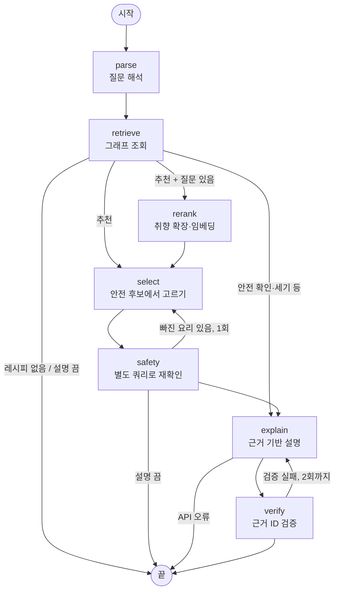

# 레시피·알레르기 GraphRAG Agent

레시피 속 숨은 알레르기를 온톨로지 지식그래프로 찾아, **근거 경로와 함께** 답하는 LangGraph Agent와 FastAPI 서버입니다.

공개 데모 [recipe-graphrag-demo](https://github.com/univ237138-spec/recipe-graphrag-demo)(Streamlit)의 질문 처리를
**LangGraph 워크플로우**로 다시 짜고, **비동기 API 서버**, **지연·토큰 기록**, **회귀 테스트**를 더했습니다.

```
질문: "우유 알레르기가 있어. 반찬 3개 추천해줘"
→ 질문 해석(LLM) → 그래프 조회 → 리랭킹 → 안전 검사 → 설명(LLM) → 근거 검증
→ 추천 3개 + 문단마다 근거 ID가 붙은 설명 + metrics {latency_ms, llm_calls, input_tokens, output_tokens}
```

## 설계 원칙

- **안전 판단은 그래프만 한다.** "이 요리에 우유가 들어 있나"는 재료 → 분류 → 알레르기 경로(Cypher)로 정한다.
  LLM은 질문 해석·질문 확장·설명 문장에만 쓴다.
- **LLM 출력은 믿지 않고 검사한다.** 질문 해석 결과는 온톨로지에 있는 값인지, 설명은 문단마다 실제 근거 ID를 인용했는지 확인한다.
- **실패해도 위험한 답은 내보내지 않는다.** 설명이 끝까지 검증을 통과하지 못하면 설명 없이 그래프 결과만 돌려준다.

## LangGraph 워크플로우 ([src/agent.py](src/agent.py))



| 노드 | 하는 일 | LLM |
|---|---|---|
| parse | 질문 → 조건 JSON (Structured Outputs). 온톨로지에 없는 알레르기·분류는 거부 | ✔ |
| retrieve | 추천: 조건에 맞는 후보 전부 / 그 밖의 질문: 결과까지 조회 | |
| rerank | 질문에서 취향만 뽑아 확장("매콤한" → 고추장, 청양고추 …) 후 임베딩. 추천일 때만 지남 | ✔ (캐시) |
| select | 확정 알레르기 요리를 뺀 **안전한 후보 안에서만** 하이브리드 점수 + MMR로 고르기 | |
| safety | 고른 요리를 별도 쿼리로 다시 확인. 빠진 요리가 있으면 그만큼 더 고르러 select로 1회 | |
| explain | 근거 목록만 주고 설명 요청. 재시도 때는 직전 검증 실패 이유를 덧붙임 | ✔ |
| verify | 모든 문단이 근거 ID를 갖고, 그 ID가 실제 근거 목록에 있는지 확인. 실패 시 2회까지 재생성 | |

재시도 횟수는 비용·지연과 맞바꿔 작게 잡았습니다 (`MAX_REQUERIES = 1`, `MAX_EXPLAIN_RETRIES = 2`).

## 채용 공고 항목과 이 프로젝트

| 공고 항목 | 이 프로젝트 |
|---|---|
| LangGraph 기반 Agent 워크플로우 | 노드 7개, 조건 분기 4곳, 재시도 루프 2개 ([src/agent.py](src/agent.py)) |
| RAG 파이프라인 (검색·Reranking) | 그래프 검색(Cypher) + 임베딩·키워드 하이브리드 점수 + MMR 다양성 ([src/rerank.py](src/rerank.py)) |
| Function Calling / 도메인 Tool | Structured Outputs(JSON Schema)로 질문을 그래프 조회 조건으로 변환 ([src/query_parser.py](src/query_parser.py)). 별도 Tool 호출 방식은 쓰지 않음 |
| FastAPI 서빙, 비동기 처리 | `POST /ask`, 동기 그래프·LLM 호출을 스레드로 돌려 이벤트 루프를 막지 않음 ([api.py](api.py)) |
| 품질 평가·회귀 테스트 | pytest 21개, API 키·DB 없이 실행. 안전 위반 0, 재시도 횟수, 입력 검증까지 확인 ([tests/](tests/)) |
| 비용·지연·품질 모니터링 | 응답마다 지연(ms)·LLM 호출 수·입력/출력 토큰. 요청이 동시에 와도 요청별로 따로 집계 |
| 테스트·예외 처리 | 입력 오류 422, LLM 해석 실패 502, 설명 실패는 200 + `llm_error` (그래프 결과는 유지) |
| 우대: Docker, AI 개발 도구 | Dockerfile(데모 앱), Claude Code로 개발 |

## 숫자

이전 프로젝트([recipe-graphrag-demo](https://github.com/univ237138-spec/recipe-graphrag-demo))에서 측정한 값입니다.

- 데이터: 레시피 1,156개, 재료 1,632개, 분류 74개, 알레르기 19개
- 3중 교차 검증(Python · OWL RL 추론 · Neo4j Cypher): 레시피 1,156개 판정 불일치 0
- 설명의 근거 충실도(faithfulness): 86.4% → 99.3% (근거 ID 강제 인용 후, 단일 실행)
- 리랭킹: 추천 다양성 19 → 36, 규칙 적합도 12 → 16/24, 안전 위반 0

이 저장소에서 실제 키로 확인한 값 (gpt-5-mini, 질문 1개): 23.7초, LLM 호출 2회, 토큰 입력 4,105 / 출력 2,525.
지연은 대부분 LLM 두 번(질문 해석·설명)에서 나옵니다.

## 실행

Python 3.12 이상.

```bash
pip install -r requirements.txt
python -m pytest -q                      # 테스트 (API 키·Neo4j 불필요)
uvicorn api:app                          # http://localhost:8000/docs
```

API 키 없이 그래프만 확인 (질문 해석·설명 생략):

```bash
curl -X POST localhost:8000/ask -H "Content-Type: application/json" \
  -d '{"conditions": {"intent": "check_safety", "recipe_name": "석류 보쌈김치", "exclude_allergens": ["새우"]}, "explain": false}'
```

자연어 질문은 환경변수 `OPENAI_API_KEY`(필수), `OPENAI_MODEL`(기본 `gpt-5-mini`)을 넣고 실행합니다.

```json
POST /ask
{"question": "우유 알레르기가 있어. 반찬 3개 추천해줘"}
```

- 그래프: `NEO4J_PASSWORD`(+ `NEO4J_URI`)가 있으면 Neo4j, 없으면 메모리 그래프([src/local_graph.py](src/local_graph.py), Neo4j 결과와 1,156개 모두 일치 확인).
- 터미널: `python src/ask.py "질문"` / 워크플로우 그림: `python src/agent.py` (Mermaid 출력)
- Streamlit 데모 앱: `streamlit run app.py` 또는 Docker (`docker build -t recipe-graphrag . && docker run --rm -p 8501:8501 recipe-graphrag`)

## 구조

```
api.py              FastAPI 서버 (POST /ask, metrics)
app.py              Streamlit 데모 앱
src/agent.py        LangGraph 워크플로우
src/ask.py          GraphRAG 클래스 (워크플로우 실행) + 터미널 실행
src/query_parser.py 질문 → 조건 (Structured Outputs + 온톨로지 검증)
src/graph_search.py Cypher 조회·안전 필터
src/rerank.py       질문 확장 + 하이브리드 점수 + MMR
src/answer.py       근거 목록, 설명 요청·검증, 안전 검사
src/llm.py          OpenAI 호출, 토큰 기록
ontology/           알레르기 온톨로지(TTL), 법령 조항
tests/              회귀 테스트
```

## 데이터 출처

- 레시피: 식품의약품안전처 식품안전나라 「조리식품의 레시피 DB」 (COOKRCP01) 오픈API
- 알레르기 법적 근거: 「식품 등의 표시·광고에 관한 법률 시행규칙」 [별표 2] (법제처 국가법령정보센터)

※ 포트폴리오용이며 의료·영양 조언이 아닙니다. 레시피 원문 기준 판정이므로 실제 제품의 알레르기 표시를 꼭 확인하세요.
