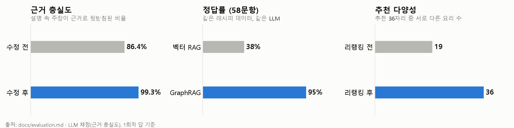

# 평가 요약

이 저장소의 질문 처리 코드(질문 해석, 그래프 조회, 리랭킹, 근거 기반 설명)는 이전 프로젝트에서 만들고 평가했습니다.
그 평가 보고서(3차 성능 평가, 추천 리랭킹 전후 평가, 2026-10-29~31)의 측정 방법과 결과를 요약합니다.
이 저장소에서 새로 더한 LangGraph 워크플로우와 API는 같은 결과를 내는지 회귀 테스트로 확인했습니다 ([tests/](../tests/)).

## 1. 무엇을 쟀나

| 층 | 질문 | 대표 지표 |
|---|---|---|
| 1층 지식 | 그래프가 레시피의 알레르기를 맞게 알고 있나 | 레시피 원문을 직접 판정한 정답 542개 대비 확정 알레르기 놓침률 |
| 2층 검색 | 조건에 맞는 요리를 빠짐없이, 위험한 것 없이 가져오나 | 재현율, 검색 오염률(빼 달라던 알레르기가 든 문서 비율) |
| 3층 답변 | 최종 답이 맞고, 설명이 근거에 기대고 있나 | 정답률(58문항), 근거 충실도(설명의 주장마다 근거 목록이 뒷받침하는지) |

- 비교 기준선: 같은 레시피를 임베딩 검색(비슷한 글 8개)해 LLM이 읽고 답하는 **벡터 RAG**.
- 모델: 질문 해석·설명·채점 gpt-5-mini (reasoning low). 정답률·반복 일치는 3회 실행, 근거 충실도는 1회차 답 기준.

## 2. 결과

| 지표 | GraphRAG | 벡터 RAG |
|---|---|---|
| 확정 알레르기 놓침률 (1,152건) | **0%** (수정 전 0.17%, 재료 글 파싱 오류 2건 수정) | — |
| 재현율 (전부 찾기 8문항) | **100%** | 19.7% |
| 검색 오염률 | **0%** | 54% (80개 중 43개) |
| 정답률 (58문항) | **95%** (55/58) | 38% (22/58) |
| 먹으면 안 되는 요리를 "먹어도 됨"이라고 답함 | 0/18 | 0/18 |
| 근거 충실도 | **99.3%** (284/286) | 68% (126/185) |

GraphRAG의 오답은 대부분 **LLM이 질문을 조회 조건으로 바꾸는 단계**에서 생겼습니다("후식" 조건 누락 등).
질문 문장과 조건을 대조하는 검사를 넓혀 84% → 95%가 됐고, 이전 평가 32문항의 답은 하나도 바뀌지 않았습니다.

## 3. 근거 충실도 86.4% → 99.3%

'뒷받침 안 됨' 주장을 다시 읽어 보니 대부분 **답은 맞는데 그 출처가 근거 목록에 빠진 경우**였습니다.

| | 수정 전 | ① 그래프 판정을 근거 `V`로 넣음 | ② 분류 조건 목록에도 경로를 붙임 |
|---|---|---|---|
| 근거 충실도 (주장 기준) | 216/250 (86.4%) | 260/285 (91.2%) | **284/286 (99.3%)** |
| 모든 주장이 뒷받침된 답 | 35/58 | 54/58 | **56/58** |

같은 질문 해석 결과로 설명만 다시 만들어 쟀습니다. 판정·개수·추천 같은 그래프 결과는 바뀌지 않았습니다.
이 구조가 지금 워크플로우의 `verify` 노드(문단마다 근거 ID 검증, 실패 시 재생성)로 이어졌습니다.

## 4. 추천 리랭킹

문제: "매콤한 반찬", "아이가 먹기 좋은 반찬"이 모두 **같은 3개**를 받았습니다 (안전한 후보를 레시피 번호순으로 골랐기 때문).
네 방식(질문 전체 임베딩 / 취향 + 확장 / 질문 전체 + 확장 / 하이브리드)을 12문항으로 비교해 하이브리드를 골랐습니다.

| 지표 (12문항, 1회) | 리랭킹 전 | 리랭킹 후 |
|---|---|---|
| 다양성: 추천 36자리 중 서로 다른 요리 | 19 | **36** |
| 취향 적합도: 재료 규칙 (매콤 → 고추류 등, 8문항) | 12/24 | **16/24** |
| 취향 적합도: LLM 채점자 (전후를 모른 채 판정) | 20/36 | 18/36 |
| 안전: 제외 알레르기 '확정' 요리 추천 | 0 | **0** |
| 회귀: 이전 추천 10문항 정답 | 10/10 | 10/10 |

- **취향 적합도는 지표에 따라 엇갈립니다.** 재료 규칙은 올랐지만 LLM 채점자는 2점 낮게 봤습니다. 12문항·1회라 ±2~4점은 우연일 수 있습니다.
  분명한 성과는 다양성과 "같은 질문에 늘 같은 답" 해소입니다.
- 숫자로 드러나는 취향("싱겁게" → 나트륨, "간단하게" → 조리 단계 수)은 어느 방식도 번호순보다 낫지 않았습니다. 레시피 숫자 속성으로 점수를 주는 것이 다음 과제입니다.

## 5. 한계

- 근거 충실도와 리랭킹 채점은 LLM 채점자 판정입니다 (사람이 모두 확인한 것이 아님).
- 근거 충실도와 리랭킹 평가는 1회 실행입니다.
- 이 저장소에서 LangGraph로 다시 짠 뒤에는 실제 API로 전체 평가를 다시 돌리지 않았습니다.
  대신 API 키 없이 같은 그래프 결과가 나오는지 회귀 테스트로 확인했습니다.
